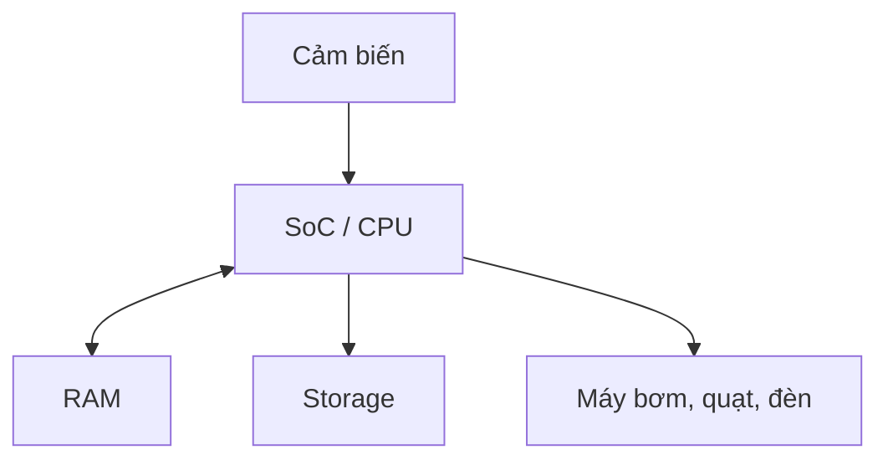
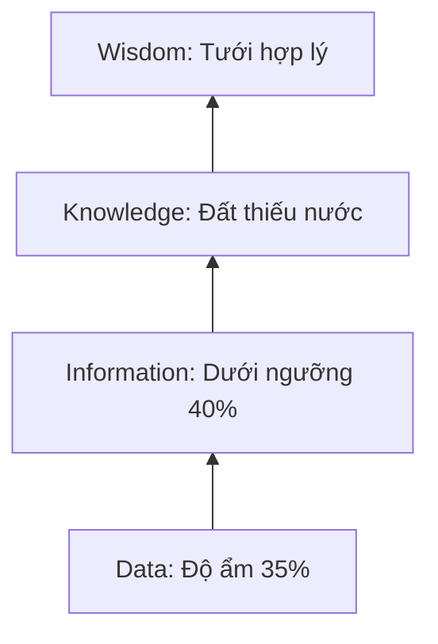



# PHẦN 1. PHÂN TÍCH HỆ THỐNG

## Input / Output

- **Input:** Cảm biến thu thập nhiệt độ, độ ẩm.
- **Process:** SoC/CPU xử lý dữ liệu.
- **Output:** Điều khiển máy bơm, quạt, đèn.

## Sơ đồ phối hợp phần cứng


# PHẦN 2. TRIỂN KHAI README.md

## 🚀 Smart-Farm

**Smart-Farm** là hệ thống IoT giúp trang trại Lan theo dõi môi trường và tưới cây tự động.

## Hướng dẫn cài đặt

```bash
sudo apt update
sudo apt install python3 -y
mkdir -p ~/Smart-Farm
cd ~/Smart-Farm
```
## Tính năng

- [ ] Đo nhiệt độ và độ ẩm.
- [ ] Tự động tưới cây.
- [ ] Cảnh báo môi trường bất thường.
- [ ] Lưu nhật ký hoạt động.

## Bảng thông số

| Thông số | Giá trị mẫu |
|---|---|
| Nhiệt độ | 32°C |
| Độ ẩm đất | 35% |
| Ngưỡng tưới | 40% |

## Chu kỳ CPU

> **Fetch:** Lấy lệnh từ RAM.
> **Decode:** Giải mã lệnh.
> **Execute:** Thực thi lệnh bật máy bơm.

## Mô hình DIKW


# PHẦN 3. KIỂM THỬ VÀ LƯU Ý

## Tình huống

Tiến trình xử lý nhật ký chiếm nhiều RAM khiến hệ thống chạy chậm.

## Cách xử lý an toàn

**Kiểm tra RAM:**
```bash
free -h
```
**Kiểm tra tiến trình:**
```bash
top
```
**Xem 50 dòng cuối của log:**
```bash
tail -n 50 logs/app.log
```
## Lưu ý
- Sao lưu nhật ký trước khi xử lý.
- Không dùng `rm -rf` tùy tiện.
- Cấu hình Log Rotation để giới hạn log.
- Không dừng máy bơm đột ngột.
- Kiểm tra RAM sau khi khắc phục.

